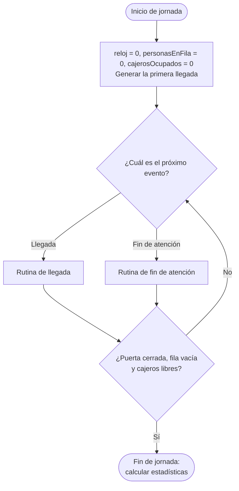
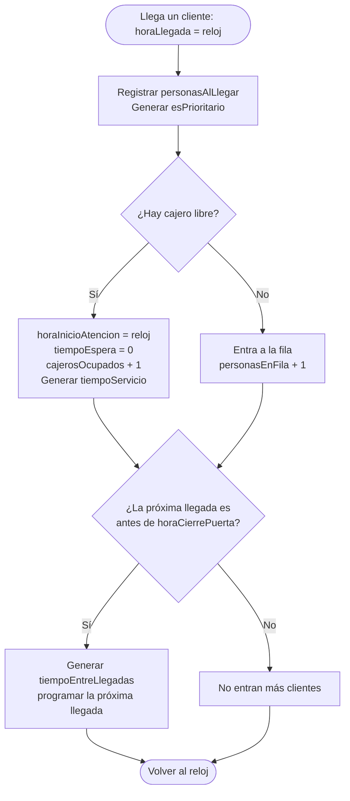
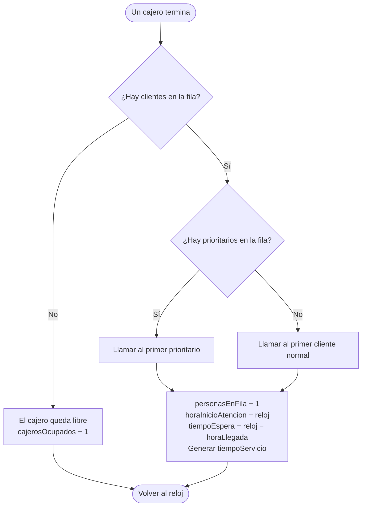

# Levantamiento de requerimientos — Capítulo 1 (Coss Bu)

## 1. Etapas necesarias para crear una simulación e implementarla en computadora

Coss Bu establece en la **Sección 1.2** las etapas metodológicas indispensables para llevar a cabo un estudio de simulación:

---

### 1.1 Definición del sistema

> Determina los límites del sistema real, sus restricciones, las variables que interactúan y las medidas de efectividad que se desean evaluar (por ejemplo: tiempo promedio de espera en cola, uso promedio de los cajeros).

#### a) Sistema real y sus límites

El sistema a simular es la **fila de atención de una sucursal bancaria (BBVA)**.

- **Horario:** lunes a viernes, en dos jornadas:
  - Mañana: 8:00 a.m. – 12:00 p.m.
  - Tarde: 2:00 p.m. – 4:30 p.m.
- **Servidores:** 5 cajeros.
- **Fila:** existe **una sola fila** que alimenta a los 5 cajeros.
- **Entrada al sistema:** toda persona que entra al banco toma un turno. Cada persona es **un cliente con un caso independiente** (si dos personas llegan juntas se cuentan como dos clientes).
- **Asignación a cajeros:** el siguiente cliente de la fila pasa al **primer cajero que se desocupe**.
- **Prioridad:** embarazadas y adultos mayores tienen prioridad; si llega uno, es atendido en cuanto se desocupe un cajero, antes que el resto de la fila.
- **Límites del sistema:**
  - **Inicio:** el sistema empieza vacío al abrir cada jornada (8:00 a.m. y 2:00 p.m.); a partir de ahí empiezan a llegar clientes.
  - **Fin:** al cierre de cada jornada (12:00 p.m. y 4:30 p.m.) se cierra la puerta y no entran más clientes, pero **se atiende a todos los que ya están adentro**. La jornada termina cuando sale el último cliente.
  - El cierre del mediodía separa el día en **dos jornadas independientes**, cada una con su propia tasa de llegadas.

#### b) Interacción con otros sistemas

Se considera un **sistema aislado**: la única interacción con el exterior es la **fuente de clientes** (la población que llega al banco). No se modelan otros servicios del banco ni el cambio entre filas, porque hay una sola fila.

#### c) Restricciones

- Los datos se toman **en la entrada de la sucursal**, sin interferir con la operación del banco: se cuenta el **número de personas que entran en intervalos de 5 minutos**, en jornada de mañana y de tarde.
- El tiempo de espera en la fila es el **resultado** que entrega la simulación.
- El **tiempo de servicio** se fija con **criterio de expertos** (Coss Bu 1.2, p. 13) en una **atención media de 6 minutos**: un valor aleatorio **uniformemente distribuido entre 1 y 11 minutos** por cliente, en cada caja. Como no se cronometró, se estudia con un análisis de sensibilidad (ver 1.6 d). El simulador también permite usar una distribución exponencial con una media dada, para comparar.
- Los conteos corresponden a un **día normal**. Los días de mayor afluencia (quincenas) se estudian como un **escenario** con 30 % más de llegadas, según criterio de expertos (ver 1.7).

#### d) Variables

| Tipo | Variable |
|------|----------|
| **Entrada** | Número de personas que entran en cada intervalo de 5 minutos (conteo); tiempo de servicio, uniforme entre 1 y 11 minutos (media 6) |
| **Decisión** | Número de cajeros (actualmente 5) |
| **Estado** | Longitud de la cola; estado de cada cajero (ocupado / ocioso) |
| **Salida** | Tiempo de espera en cola; número de clientes en el sistema |

#### e) Interrelaciones

- A **más llegadas** por intervalo → **crece la cola** → **aumenta el tiempo de espera**.
- A **mayor tiempo de servicio** → los cajeros permanecen ocupados más tiempo → **crece la cola**.
- A **más cajeros** → **disminuyen** la cola y el tiempo de espera, pero **aumenta el tiempo ocioso** de los cajeros.
- La **prioridad** de embarazadas y adultos mayores **aumenta la espera** del resto de los clientes.

#### f) Medidas de efectividad

1. **L — número promedio de clientes en el sistema** (en la fila + siendo atendidos) — responde a *"al llegar, ¿cuántas personas habrá en el banco?"*
2. **Lq — número promedio de clientes en la fila.**
3. **W — tiempo promedio que un cliente pasa en el sistema** (espera + atención).
4. **Wq — tiempo promedio de espera en la fila** — responde a *"¿cuánto tiempo aproximado me tocará esperar?"*
5. **Utilización de los cajeros** — porcentaje del tiempo que los cajeros están ocupados.

#### g) Resultados esperados

Estimar, para cada jornada (mañana y tarde) y para un día normal y uno de quincena, las medidas L, Lq, W y Wq con intervalos de confianza del 95 %.

---

### 1.2 Formulación del modelo

> Definir las relaciones lógicas entre las variables, elaborar los diagramas de flujo y fijar las reglas de operación del sistema (por ejemplo, atención por orden de llegada *First-Come, First-Served*).


#### a) Tipo de modelo

- **Estocástico:** las llegadas y los tiempos de servicio son aleatorios.
- **Dinámico y discreto:** el estado del sistema solo cambia en instantes puntuales (cuando llega o sale un cliente).
- **De horizonte finito (terminal):** cada jornada empieza vacía y termina cuando sale el último cliente. Cada jornada simulada es **una corrida independiente**.
- **Avance del tiempo:** por **incrementos al próximo evento** (el reloj salta de un evento al siguiente).

#### b) Componentes del modelo

| Componente | En el banco | Atributos |
|---|---|---|
| **Entidad** | Cliente | `horaLlegada`, `esPrioritario`, `horaInicioAtencion`, `horaSalida` |
| **Servidores** | 5 cajeros | `estaOcupado`, `horaFinAtencion` |
| **Cola** | Una sola fila | Clientes en espera, ordenados por prioridad y luego por hora de llegada |
| **Fuente** | Población que entra al banco | `tasaLlegadas` (una para mañana y otra para tarde) |

#### c) Cómo entran los datos al modelo

Los datos **no** son tiempos entre llegadas: son **conteos de personas que entran en cada intervalo de 5 minutos** (ver 1.3). El modelo los usa así:

1. **Dato observado:** `llegadasPorIntervalo` = número de personas que entraron en cada intervalo de 5 minutos.
2. **Parámetro:** `tasaLlegadas` = promedio de `llegadasPorIntervalo` (personas por 5 minutos), uno para la mañana y otro para la tarde. Ese conteo se modela con una distribución **Poisson**.
3. **Variable generada en la simulación:** `tiempoEntreLlegadas`. Coss Bu (Ejemplo 4.11) muestra que, si el número de llegadas en un intervalo es Poisson con media λ, el tiempo entre una llegada y la siguiente es **exponencial con media 1/λ**. Así el modelo puede saber **a qué minuto exacto** llega cada cliente, que es lo que necesita para calcular esperas.

```text
llegadasPorIntervalo (dato) → tasaLlegadas (promedio) → tiempoEntreLlegadas (se genera en la simulación)
```

#### d) Variables del modelo

**Parámetros (se fijan antes de simular):**

| Nombre | Significado | Valor |
|---|---|---|
| `tasaLlegadasManana` | Personas que llegan, en promedio, cada 5 minutos en la mañana | 5.70 (ver 1.3) |
| `tasaLlegadasTarde` | Personas que llegan, en promedio, cada 5 minutos en la tarde | 4.50 (ver 1.3) |
| `numeroCajeros` | Cajeros que atienden | 5 |
| `tiempoServicioMin` | Tiempo mínimo de atención | 1 min |
| `tiempoServicioMax` | Tiempo máximo de atención (media de 6 min) | 11 min |
| `horaApertura` | Inicio de la jornada | 8:00 / 2:00 |
| `horaCierrePuerta` | Hora en que dejan de entrar clientes | 12:00 / 4:30 |
| `proporcionPrioritarios` | Fracción de clientes que son embarazadas o adultos mayores | 0.05 |
| `factorQuincena` | Multiplicador de llegadas en días de quincena (escenario) | 1.30 |
| `numeroCorridas` | Días simulados por jornada y escenario | 30 |
| `alfa` | Nivel de significancia de las pruebas K-S y chi-cuadrada | 0.05 |
| `limiteIntentos` | Veces que se repite una corrida que no pasa la prueba K-S antes de detener la simulación | 10 |

**Variables por cliente:**

| Nombre | Significado | Cómo se calcula |
|---|---|---|
| `tiempoEntreLlegadas` | Minutos desde que llegó el cliente anterior | Se genera (exponencial) |
| `horaLlegada` | Minuto en que entra al banco | `horaLlegada` del anterior + `tiempoEntreLlegadas` |
| `esPrioritario` | Si es embarazada o adulto mayor | Se genera con `proporcionPrioritarios` |
| `tiempoServicio` | Minutos que tarda el cajero con él | Se genera (uniforme entre 1 y 11) |
| `horaInicioAtencion` | Minuto en que un cajero lo llama | Cuando se desocupa un cajero y es su turno |
| `horaSalida` | Minuto en que sale | `horaInicioAtencion` + `tiempoServicio` |
| `tiempoEspera` | Minutos que estuvo en la fila | `horaInicioAtencion` − `horaLlegada` |
| `personasAlLlegar` | Personas que había en el banco cuando entró | Se registra al momento de llegar |

**Variables de estado (describen al banco en cada instante):**

| Nombre | Significado |
|---|---|
| `reloj` | Minuto actual de la simulación |
| `personasEnFila` | Clientes esperando en la fila |
| `cajerosOcupados` | Cajeros atendiendo a alguien |
| `personasEnBanco` | `personasEnFila` + `cajerosOcupados` |
| `listaEventos` | Próxima llegada y hora de fin de cada cajero ocupado |

#### e) Eventos

| Evento | Qué lo provoca | Qué cambia |
|---|---|---|
| **Llegada de un cliente** | Se cumple el `tiempoEntreLlegadas` | Aumenta `personasEnFila` o `cajerosOcupados` |
| **Fin de atención** | Un cajero llega a su `horaFinAtencion` | Disminuye `cajerosOcupados`, o el cajero llama al siguiente de la fila |
| **Cierre de puerta** | `reloj` llega a `horaCierrePuerta` | Se dejan de generar llegadas; se sigue atendiendo a los de adentro |

**Lista de eventos:** en todo momento se guarda la hora de la próxima llegada y la `horaFinAtencion` de cada cajero ocupado. El `reloj` salta al **menor** de esos tiempos.

#### f) Reglas de operación

1. **Al llegar un cliente:**
   - Si hay un cajero libre (`cajerosOcupados < numeroCajeros`), pasa directo: `horaInicioAtencion = horaLlegada` y `tiempoEspera = 0`.
   - Si todos están ocupados, entra a la fila.
2. **Al terminar un cajero:**
   - Si la fila está vacía, el cajero queda libre.
   - Si hay clientes en la fila, llama al siguiente según la disciplina de la fila.
3. **Disciplina de la fila:**
   - Primero se atiende a los **prioritarios**, en orden de llegada entre ellos.
   - Después a los **normales**, en orden de llegada (*First-Come, First-Served*).
   - La prioridad **no interrumpe** una atención en curso.
4. **Asignación de cajero:** el cliente pasa al **primer cajero que se desocupe**. Si hay varios libres, el de menor número.
5. **Cierre:** a partir de `horaCierrePuerta` no entran más clientes. La jornada termina cuando la fila está vacía y no hay cajeros ocupados.
6. **Supuestos:**
   - Una sola fila para los 5 cajeros.
   - Cada persona es un caso independiente.
   - Nadie se va sin ser atendido.
   - Los 5 cajeros trabajan al mismo ritmo.
   - Las jornadas de mañana y tarde son independientes y empiezan vacías.

#### g) Diagramas de flujo

**Lógica general (próximo evento):**



**Rutina de llegada:**



**Rutina de fin de atención:**



#### h) Cálculo de las medidas de efectividad

- **`esperaPromedio`** = suma de `tiempoEspera` de todos los clientes ÷ número de clientes.
- **`personasPromedioEnBanco`** = cada vez que ocurre un evento se suma `personasEnBanco` × (minutos desde el evento anterior); al final se divide entre la duración de la jornada.
- **`personasPromedioAlLlegar`** = promedio de `personasAlLlegar` de todos los clientes.
- **`utilizacionCajeros`** = suma de `tiempoServicio` ÷ (`numeroCajeros` × duración de la jornada).

#### i) Tabla de simulación manual

Adaptación de la Tabla 5.19 de Coss Bu (Ejemplo 5.6) a 5 cajeros:

| Cliente | Prioritario | Aleatorio 1 | tiempoEntreLlegadas | horaLlegada | Cajero | horaInicioAtencion | Aleatorio 2 | tiempoServicio | horaSalida | tiempoEspera | personasAlLlegar |
|---|---|---|---|---|---|---|---|---|---|---|---|
| 1 | | | | | | | | | | | |
| 2 | | | | | | | | | | | |
| 3 | | | | | | | | | | | |

- **Aleatorio 1:** número entre 0 y 1 que se convierte en `tiempoEntreLlegadas`.
- **Aleatorio 2:** número entre 0 y 1 que se convierte en `tiempoServicio`.

---

### 1.3 Colección de datos

> Identificar y recolectar la información histórica necesaria para determinar las distribuciones de probabilidad que rigen el comportamiento de las entradas (tiempos entre llegadas de clientes y tiempos de atención).

**Mi contenido:**

#### a) Fuente de los datos

Observación directa **en la entrada de la sucursal**, en jornada de mañana y de tarde, contando las personas que entran en cada intervalo de 5 minutos. Es un **día normal** (fuera de quincena).

La mañana se observó de 9:40 a 11:40 (24 intervalos) y la tarde de 2:00 a 4:30 (30 intervalos). Para que la mañana también tenga **30 intervalos**, se agregaron **6 conteos estimados** de 9:10 a 9:40: una muestra de una distribución Poisson con la media de los 24 observados (130 ÷ 24 = 5.42), generada con la semilla 2026 (`numpy.random.default_rng(2026).poisson(130 / 24, 6)`). No son observaciones: en las tablas van marcados con \*.

**Cómo se obtiene la tasa:** se suman las personas de todos los intervalos y se divide entre el número de intervalos. Mañana: 171 ÷ 30 = 5.70 personas cada 5 minutos. Tarde: 135 ÷ 30 = 4.50 personas cada 5 minutos. Por azar, los 6 estimados suman 41 (6.8 por intervalo), así que la tasa de la mañana sube de 5.42 (solo observados) a 5.70.

#### b) Datos de llegadas — jornada de la mañana (9:10 a 11:40)

| Intervalo | Personas | Intervalo | Personas | Intervalo | Personas |
|---|---|---|---|---|---|
| 9:10 – 9:15 * | 7 | 10:00 – 10:05 | 4 | 10:50 – 10:55 | 3 |
| 9:15 – 9:20 * | 10 | 10:05 – 10:10 | 7 | 10:55 – 11:00 | 9 |
| 9:20 – 9:25 * | 4 | 10:10 – 10:15 | 5 | 11:00 – 11:05 | 6 |
| 9:25 – 9:30 * | 5 | 10:15 – 10:20 | 11 | 11:05 – 11:10 | 4 |
| 9:30 – 9:35 * | 9 | 10:20 – 10:25 | 8 | 11:10 – 11:15 | 8 |
| 9:35 – 9:40 * | 6 | 10:25 – 10:30 | 2 | 11:15 – 11:20 | 7 |
| 9:40 – 9:45 | 7 | 10:30 – 10:35 | 4 | 11:20 – 11:25 | 2 |
| 9:45 – 9:50 | 9 | 10:35 – 10:40 | 6 | 11:25 – 11:30 | 3 |
| 9:50 – 9:55 | 8 | 10:40 – 10:45 | 3 | 11:30 – 11:35 | 4 |
| 9:55 – 10:00 | 6 | 10:45 – 10:50 | 1 | 11:35 – 11:40 | 3 |

\* Conteo estimado (Poisson con media 5.42), no observado.

#### c) Datos de llegadas — jornada de la tarde (2:00 a 4:30)

| Intervalo | Personas | Intervalo | Personas | Intervalo | Personas |
|---|---|---|---|---|---|
| 2:00 – 2:05 | 3 | 2:50 – 2:55 | 4 | 3:40 – 3:45 | 9 |
| 2:05 – 2:10 | 3 | 2:55 – 3:00 | 4 | 3:45 – 3:50 | 3 |
| 2:10 – 2:15 | 2 | 3:00 – 3:05 | 6 | 3:50 – 3:55 | 7 |
| 2:15 – 2:20 | 3 | 3:05 – 3:10 | 3 | 3:55 – 4:00 | 6 |
| 2:20 – 2:25 | 3 | 3:10 – 3:15 | 7 | 4:00 – 4:05 | 4 |
| 2:25 – 2:30 | 7 | 3:15 – 3:20 | 4 | 4:05 – 4:10 | 2 |
| 2:30 – 2:35 | 9 | 3:20 – 3:25 | 8 | 4:10 – 4:15 | 3 |
| 2:35 – 2:40 | 4 | 3:25 – 3:30 | 5 | 4:15 – 4:20 | 3 |
| 2:40 – 2:45 | 7 | 3:30 – 3:35 | 3 | 4:20 – 4:25 | 2 |
| 2:45 – 2:50 | 6 | 3:35 – 3:40 | 5 | 4:25 – 4:30 | 0 |

#### d) Resumen

| Jornada | Intervalos observados | Total de personas | Promedio por 5 min (`tasaLlegadas`) | Varianza |
|---|---|---|---|---|
| Mañana | 30 (2.5 horas: 24 observados + 6 estimados) | 171 | 5.70 | 6.77 |
| Tarde | 30 (2.5 horas) | 135 | 4.50 | 5.02 |

En ambas jornadas el promedio y la varianza son parecidos, que es lo que se espera de una distribución **Poisson**. La prueba chi-cuadrada de bondad de ajuste lo confirma con $\alpha = 0.05$ (las clases se agrupan hasta esperar al menos 5 intervalos en cada una):

| Jornada | $\chi^2$ | Grados de libertad | Valor crítico | Resultado |
|---|---|---|---|---|
| Mañana | 1.519 | 2 | 5.991 | Se acepta la Poisson |
| Tarde | 5.467 | 3 | 7.815 | Se acepta la Poisson |

Como exige la prueba, las clases se agrupan hasta que cada una espera al menos 5 intervalos: en la mañana quedan 4 clases (2 grados de libertad) y en la tarde 5 (3 grados de libertad).

Los 6 conteos estimados salen de una Poisson, así que no cuentan como evidencia a favor de la Poisson. Con solo los 24 observados la prueba también la acepta: $\chi^2$ = 1.936 con 1 grado de libertad, contra un valor crítico de 3.841.

#### e) Distribuciones de entrada

| Dato | Distribución | Parámetros | Fuente |
|---|---|---|---|
| Personas que llegan en 5 min | Poisson | Mañana: 5.70 · Tarde: 4.50 | Conteo en la entrada (6 conteos de la mañana estimados) |
| `tiempoEntreLlegadas` | Exponencial | Media mañana: 5 ÷ 5.70 = 0.88 min · Media tarde: 5 ÷ 4.50 = 1.11 min | Derivada del conteo (Ejemplo 4.11) |
| `tiempoServicio` | Uniforme | Mínimo 1 min, máximo 11 min (media 6 min) | Criterio de expertos |
| `esPrioritario` | Bernoulli | 5 % de los clientes | Criterio de expertos |

#### f) Supuestos

- Los conteos de la mañana van de **9:10 a 11:40** (los de 9:10 a 9:40 son estimados); su ritmo de 5.70 personas cada 5 minutos se aplica a toda la jornada de 8:00 a 12:00.
- La puerta de la tarde cierra a las **4:30 p.m.**
- El ritmo de llegadas es constante dentro de cada jornada (condición para usar la relación Poisson–exponencial).

#### g) Capacidad del sistema

| Jornada | Llegan (personas/min) | Pueden atender 5 cajeros con media de 6 min (personas/min) | Relación llegadas ÷ capacidad |
|---|---|---|---|
| Mañana | 1.14 | 5 ÷ 6 = 0.83 | **1.37** |
| Tarde | 0.90 | 0.83 | **1.08** |

Cuando la relación es mayor que 1, llega más gente de la que los cajeros pueden atender y la fila crece durante toda la jornada. En la mañana llega 37 % más gente de la que 5 cajeros pueden atender; la tarde está apenas por encima del límite. Las consecuencias se analizan en 1.6.


---

### 1.4 Construcción del generador de variables aleatorias

#### a) Números aleatorios rectangulares $U(0,1)$

> Implementar algoritmos congruenciales (Capítulo 2) para generar secuencias aleatorias entre $0$ y $1$.

**Mi contenido:**

- **Generador usado:** `random.random()` de Python, que implementa el algoritmo **Mersenne Twister** (periodo $2^{19937} - 1$). Es un generador ampliamente probado; el curso de Coss Bu (capítulo 2) presenta los congruenciales, y este proyecto usa el de Python en su lugar.
- **Semilla:** se puede fijar en el front (por ejemplo 12345) para que los resultados se puedan repetir. Si se deja vacía, cada simulación usa números distintos.
- **Validación de cada corrida:** antes de usar una corrida, sus números aleatorios de llegada y de servicio se prueban por separado con Kolmogorov-Smirnov (ver 1.6 a). Si alguna de las dos listas no pasa, la corrida se descarta y se simula de nuevo.

#### b) Variables no uniformes

> Transformar los números $U(0,1)$ a las distribuciones reales del sistema mediante métodos como la Transformada Inversa ($X = F^{-1}(R)$) o el Método de Rechazo (Capítulo 4).

**Mi contenido:**

- **Método de transformación:** transformada inversa (Coss Bu, 4.1). Se iguala la distribución acumulada al número aleatorio, $F(x) = R$, y se despeja $x$.

**Tiempo entre llegadas (exponencial, ecuación 4.3):**

$$x = -\frac{5}{\text{tasaLlegadas}} \ln (1 - R)$$

| Jornada | Día normal | Quincena (+30 %) |
|---|---|---|
| Mañana | $x = -0.877 \ln (1 - R)$ | $x = -0.675 \ln (1 - R)$ |
| Tarde | $x = -1.111 \ln (1 - R)$ | $x = -0.855 \ln (1 - R)$ |

Se usa $1 - R$ porque `random.random()` puede devolver 0 pero nunca 1, así que $\ln(1 - R)$ siempre existe. Como $1 - R$ también es uniforme entre 0 y 1, la distribución es la misma que con $\ln R$.

Ejemplo: si $R = 0.50$ en la mañana normal, $x = -0.877 \times \ln(0.50) = 0.61$ minutos hasta la siguiente llegada.

**Tiempo de servicio (uniforme entre 1 y 11):**

$$x = 1 + 10R$$

Ejemplo: $R = 0.50$ da $x = 6$ minutos.

**Cliente prioritario (Bernoulli):** si $R < 0.05$, el cliente es prioritario.

---

### 1.5 Implementación del modelo en la computadora

> Codificar la lógica del modelo en un lenguaje de programación (C, Python, Java) o en paquetes especializados de simulación (como GPSS) [Capítulo 7]. La programación debe gestionar:
>
> - **El reloj de simulación:** avanzar el tiempo mediante el enfoque de incrementos al próximo evento (llegadas o salidas).
> - **El seguimiento de estados:** controlar el estado de cada servidor (ocupado/ocioso), el contenido de la cola y los eventos futuros.

**Mi contenido:**

- **Lenguaje / herramienta:** Python 3 para el modelo. El modelo, el reloj y la prueba K-S están escritos a mano; se usan librerías solo para lo demás: **SciPy** (valores t y chi-cuadrada), **Ciw** (validación independiente) y **FastAPI** (API).
- **Estructura:** la lógica está en [simulador2/](simulador2/) y se expone como una API JSON ([simulador2/api.py](simulador2/api.py)). El front ([front/](front/), Vue 3) es un asistente de 4 pasos que pide las variables de entrada y muestra los resultados con gráficas y una animación del banco.
- **Funcionamiento:** el usuario define en el front las cajas, las jornadas, los datos observados, el escenario (día normal o quincena), el número de corridas, el nivel de significancia α y el límite de intentos. El simulador hace las corridas, valida cada una con la prueba K-S y devuelve los promedios con su intervalo de confianza.
- **Manejo del reloj:** se generan las llegadas de la jornada y, cada vez que una caja se libera (la que se libera primero), pasa el siguiente de la fila: un prioritario que ya esté esperando o, si no hay, el primero en llegar.
- **Variables de estado:** `cajaLibreEn` (minuto en que cada caja termina) y la lista de clientes pendientes.

**Correspondencia entre el documento y el programa:**

| Sección del documento | Archivo | Contenido |
|---|---|---|
| 1.2 d) Parámetros y 1.3 Datos | [front/src/pasos/](front/src/pasos/), [simulador2/api.py](simulador2/api.py), [simulador2/iniciador.py](simulador2/iniciador.py) | Pasos del asistente, valores por defecto (`Entrada`), `armarJornadas` |
| 1.4 Números aleatorios y transformada inversa | [simulador2/iniciador.py](simulador2/iniciador.py) | `generarExponencial`, `generarUniforme` |
| 1.2 f–g) Reglas y flujo | [simulador2/iniciador.py](simulador2/iniciador.py) | `modelo`, `atender`, `siguienteEnFila` |
| 1.2 h) Medidas de efectividad | [simulador2/medidas.py](simulador2/medidas.py) | `calcularMedidas` |
| 1.3 Prueba de Poisson de los conteos | [simulador2/pruebaPoisson.py](simulador2/pruebaPoisson.py) | `pruebaChiCuadradaPoisson` |
| 1.6 a) Prueba K-S | [simulador2/pruebaKS.py](simulador2/pruebaKS.py), [simulador2/iniciador.py](simulador2/iniciador.py) | `pruebaKS`, `validarUniformidadPruebaKS` |
| 1.6 b) Validación con una implementación independiente | [simulador2/validacionCiw.py](simulador2/validacionCiw.py) | `compararConCiw` (prueba t de Welch) |
| Cajas necesarias para una meta de espera | [simulador2/iniciador.py](simulador2/iniciador.py) | `buscarCajasNecesarias` |
| 1.7 Corridas | [simulador2/iniciador.py](simulador2/iniciador.py) | `simularCorridas` |
| 1.8 Intervalos de confianza | [simulador2/medidas.py](simulador2/medidas.py) | `resumirCorridas`, `valorT95` (t de Student con SciPy) |
| API y front | [simulador2/api.py](simulador2/api.py), [front/](front/) | FastAPI (`/api/simular`, `/api/cajas-necesarias`, `/api/poisson`) y Vue 3 |

**Traza del primer día simulado** (mañana, día normal, 5 cajas, servicio uniforme de 1 a 11 min, semilla 12345, primeros 12 clientes; minutos desde las 8:00):

| Cliente | Prioritario | Llegada | Cajero | Inicio | Servicio | Salida | Espera | Personas al llegar |
|---|---|---|---|---|---|---|---|---|
| 1 | Sí | 0.47 | 1 | 0.47 | 2.85 | 3.32 | 0.00 | 0 |
| 2 | No | 2.00 | 2 | 2.00 | 8.13 | 10.13 | 0.00 | 1 |
| 3 | No | 2.41 | 3 | 2.41 | 10.33 | 12.74 | 0.00 | 2 |
| 4 | No | 3.14 | 4 | 3.14 | 10.07 | 13.21 | 0.00 | 3 |
| 5 | No | 3.25 | 5 | 3.25 | 4.66 | 7.92 | 0.00 | 4 |
| 6 | No | 3.98 | 1 | 3.98 | 1.12 | 5.09 | 0.00 | 4 |
| 7 | No | 4.69 | 1 | 5.09 | 8.69 | 13.78 | 0.41 | 5 |
| 8 | No | 7.47 | 5 | 7.92 | 5.62 | 13.53 | 0.45 | 5 |
| 9 | No | 10.84 | 2 | 10.84 | 6.45 | 17.29 | 0.00 | 4 |
| 10 | No | 11.46 | 3 | 12.74 | 7.56 | 20.30 | 1.28 | 5 |
| 11 | No | 12.57 | 5 | 13.53 | 6.18 | 19.71 | 0.96 | 6 |
| 12 | Sí | 12.94 | 4 | 13.21 | 9.12 | 22.32 | 0.27 | 6 |

El cliente 12 es prioritario: llega después del 11, pero pasa primero a la caja 4 cuando esta se libera (minuto 13.21). El 11 espera a que se libere la caja 5 (minuto 13.53).

---

### 1.6 Validación del modelo

> Comprobar que el modelo computacional represente fielmente la realidad mediante comparación con datos históricos, opiniones de expertos o pruebas de falla.

**Mi contenido:**

#### a) Prueba de Kolmogorov-Smirnov de los números aleatorios (Coss Bu, 3.5)

Hipótesis: los números $R$ provienen de una distribución uniforme entre 0 y 1. Nivel de significancia $\alpha = 0.05$.

- **Estadístico:** $D = \max(D^+, D^-)$, la mayor distancia entre la acumulada observada y la de la uniforme. Coincide con `scipy.stats.kstest` (lo comprueban las pruebas del programa).
- **Valor crítico:** $c(\alpha) / \sqrt{n}$ para $n > 35$ (1.22, 1.36 y 1.63 con $\alpha$ = 0.10, 0.05 y 0.01). Para $n \le 35$ se usa una aproximación de la tabla del libro.
- **Procedimiento:** en cada corrida se prueban por separado los $R$ de las llegadas y los $R$ de los servicios. Si alguna de las dos listas no pasa, la corrida se descarta y se repite; si una corrida no pasa en 10 intentos, la simulación se detiene con un error.

| Escenario (30 corridas) | Corridas aceptadas | Intentos descartados | Números por lista ($n$) | Valor crítico |
|---|---|---|---|---|
| Día normal | 30 | 2 | 358 – 443 | 0.0645 – 0.0718 |
| Quincena | 30 | 1 | 500 – 574 | 0.0567 – 0.0607 |

Descartar algunas corridas es lo esperado y no indica un problema del generador: con dos pruebas por corrida al 5 %, cerca del 10 % de las corridas falla solo por azar.

#### b) Verificación contra una implementación independiente (librería Ciw)

Para comprobar que el programa calcula bien, se simuló **el mismo banco** con la librería de colas Ciw: 5 cajas, servicio uniforme de 1 a 11 minutos, 5 % de prioritarios y cierre de la puerta. Ciw es un programa escrito por otras personas, así que un error en el modelo propio no se repetiría en él. Cada medida se compara con la prueba t de Welch (30 corridas de cada simulador): si el valor p es mayor que 0.05, no hay diferencia significativa.

| Medida | Mañana: propio | Mañana: Ciw | Valor p | Tarde: propio | Tarde: Ciw | Valor p |
|---|---|---|---|---|---|---|
| L (clientes en el sistema) | 41.8 | 42.9 | 0.709 | 12.5 | 12.7 | 0.913 |
| Lq (clientes en la fila) | 37.0 | 38.0 | 0.711 | 7.9 | 8.1 | 0.911 |
| W (min en el sistema) | 51.2 | 52.9 | 0.639 | 16.2 | 16.2 | 0.992 |
| Wq (min en la fila) | 45.3 | 46.8 | 0.649 | 10.2 | 10.3 | 0.984 |
| Wq prioritarios (min) | 1.01 | 1.07 | 0.416 | 0.90 | 1.07 | 0.117 |
| Wq normales (min) | 47.7 | 49.2 | 0.669 | 10.7 | 10.8 | 0.938 |
| Utilización | 97.7 % | 97.8 % | 0.569 | 92.2 % | 92.2 % | 0.988 |

Ninguna de las 14 comparaciones muestra una diferencia significativa: el programa reproduce los resultados de una implementación independiente, incluidos los cajeros múltiples, la prioridad y el cierre de la puerta. Esta prueba reemplaza la verificación con un modelo M/M/1, que no ponía a prueba ninguna de esas tres cosas.

Con 30 corridas, la t de Welch solo detecta diferencias grandes. Como confirmación más fuerte se repitió la comparación con **1000 corridas de cada simulador** (sin filtro K-S, semilla 2024):

| Medida | Mañana: propio | Mañana: Ciw | $z$ | Tarde: propio | Tarde: Ciw | $z$ |
|---|---|---|---|---|---|---|
| Wq (min en la fila) | 44.12 | 44.06 | 0.13 | 9.55 | 9.67 | −0.45 |
| L (clientes en el sistema) | 40.80 | 40.75 | 0.13 | 12.06 | 12.17 | −0.52 |
| Utilización | 97.8 % | 97.8 % | −0.16 | 92.5 % | 92.7 % | −0.86 |

Ninguna diferencia pasa de una desviación estándar ($|z| < 1$; haría falta $|z| > 1.96$ para que fuera significativa).

#### c) Comprobación interna

La longitud promedio $L$ se calcula de dos formas: como la suma de los tiempos que cada cliente pasó en el banco dividida entre la duración, y como $\sum n \cdot P(n)$ a partir de la tabla de longitudes. Las pruebas del programa comprueban que ambas dan lo mismo, y que las probabilidades $P(n)$ suman 1. También comprueban el modelo contra tablas calculadas a mano.

#### d) Validación contra la realidad (opinión de expertos, Coss Bu 1.2)

Los expertos fijan la **atención media en 6 minutos** (uniforme entre 1 y 11), un tiempo realista para una transacción en caja. Con ese valor los resultados son coherentes con lo que se ve en una sucursal congestionada:

- En la mañana la espera promedio es de **45 minutos** y el último cliente sale en promedio a la **1:39 p.m.**, antes de que abra la jornada de la tarde.
- La tarde está cerca del límite: espera promedio de **10 minutos** y el último cliente sale a las **4:57 p.m.**

Como el tiempo de servicio no se cronometró y es el parámetro que más pesa en la espera, se le hace un **análisis de sensibilidad** (mañana, día normal, 5 cajas, 30 corridas por caso, semilla 12345):

| Tiempo de servicio | Media | Espera promedio en fila (Wq) | Clientes en el sistema (L) | Hora en que sale el último cliente |
|---|---|---|---|---|
| 1 – 15 min | 8.0 min | 98.5 min | 65.5 | 3:30 p.m. |
| **1 – 11 min (base)** | **6.0 min** | **45.3 min** | **41.8** | **1:39 p.m.** |
| 1 – 10 min | 5.5 min | 32.5 min | 33.7 | 1:12 p.m. |
| 1 – 8 min | 4.5 min | 10.0 min | 15.4 | 12:22 p.m. |
| 1 – 7 min | 4.0 min | 3.5 min | 8.4 | 12:09 p.m. |
| 1 – 6 min | 3.5 min | 1.1 min | 5.3 | 12:05 p.m. |

**Conclusión de la validación:** el programa funciona correctamente (puntos a, b y c) y la espera es muy sensible al tiempo de servicio: medio minuto más o menos de atención media cambia la espera de la mañana en más de 10 minutos. Con la media de 6 minutos, 5 cajeros no alcanzan a atender a 5.70 personas cada 5 minutos sin que la fila crezca. Con 4.5 minutos la espera de la mañana queda justo en el límite de 10 minutos; para que 5 cajeros cumplan con holgura, la atención media debe ser de unos **4 minutos o menos**. Cronometrar la atención real en caja es lo que más mejoraría el modelo; el simulador recalcula todo con el valor medido cambiando solo el paso 2.

---

### 1.7 Experimentación y tamaño de la muestra

> Definir el número de corridas o réplicas ($N$) necesarias para evitar el sesgo por estado transitorio (condiciones iniciales) y alcanzar el estado estable (Capítulo 6).

**Mi contenido:**

- **Número de réplicas ($N$):** el usuario elige el número de corridas en el paso 3 del front (por defecto **30**). Cada corrida es un día completo, con mañana y tarde, y usa números aleatorios distintos porque continúa la secuencia del generador. Los resultados de este documento usan **30 corridas por escenario** con la semilla 12345.
- **Periodo de calentamiento (estado transitorio):** **no se usa**. El sistema es **terminal**: el banco real abre vacío cada jornada y cierra al final, así que la etapa inicial con el banco vacío forma parte de lo que se quiere medir. Coss Bu (1.3.3) trata el estado transitorio como un problema cuando se estudia el **estado estable**, que no es este caso.
- **Justificación:** cada día simulado es una corrida independiente. El intervalo de confianza usa la distribución $t$ de Student con $n - 1$ grados de libertad (Coss Bu, ecuación 6.7), calculada con SciPy para cualquier $n$: con 10 corridas, $t = 2.262$; con 30, $t = 2.045$. Cuantas más corridas, más angosto queda el intervalo. Coss Bu (1.3.4) lo llama determinar el tamaño de muestra "durante la operación del modelo": se aumentan las corridas hasta que el intervalo es lo bastante angosto.
- **Escenarios (diseño de experimentos, Coss Bu 1.3.5):**

| Escenario | Personas cada 5 min (mañana) | Personas cada 5 min (tarde) |
|---|---|---|
| Día normal | 5.70 | 4.50 |
| Quincena (+30 %) | 7.41 | 5.85 |

---

### 1.8 Interpretación y análisis de resultados

> Calcular estimadores puntuales e intervalos de confianza para las variables de interés.

**Mi contenido:**

- **Estimadores puntuales:** el promedio de todos los días simulados de cada medida.
- **Intervalos de confianza:** 95 %, con la ecuación 6.7 de Coss Bu, donde $n$ es el número de días simulados:

$$\bar{x} \pm t_{0.025,\,n-1} \cdot \frac{S}{\sqrt{n}}$$

#### Resultados con servicio uniforme entre 1 y 11 minutos (5 cajas, 30 corridas por escenario, semilla 12345)

| Medida | Mañana normal | Tarde normal | Mañana quincena | Tarde quincena |
|---|---|---|---|---|
| Clientes atendidos | 277 (271 – 283) | 136 (131 – 141) | 360 (353 – 366) | 180 (174 – 185) |
| **L** — clientes en el sistema | 41.8 (38.2 – 45.5) | 12.5 (10.5 – 14.6) | 82.7 (79.5 – 86.0) | 30.8 (27.9 – 33.7) |
| **Lq** — clientes en la fila | 37.0 (33.3 – 40.6) | 7.9 (5.9 – 9.9) | 77.8 (74.6 – 81.1) | 25.9 (23.0 – 28.8) |
| **W** — minutos en el sistema | 51.2 (46.7 – 55.7) | 16.2 (13.6 – 18.8) | 100.6 (96.4 – 104.8) | 38.3 (34.5 – 42.1) |
| **Wq** — minutos de espera en fila | 45.3 (40.8 – 49.7) | 10.2 (7.7 – 12.8) | 94.6 (90.4 – 98.8) | 32.3 (28.5 – 36.1) |
| Wq prioritarios (min) | 1.0 (0.9 – 1.1) | 0.9 (0.8 – 1.0) | 1.1 (1.0 – 1.2) | 1.0 (0.9 – 1.2) |
| Wq normales (min) | 47.7 (43.0 – 52.4) | 10.7 (8.0 – 13.3) | 99.4 (94.9 – 103.8) | 33.9 (29.9 – 37.8) |
| Utilización de los cajeros | 97.7 % | 92.2 % | 98.5 % | 96.7 % |
| Sale el último cliente | 1:39 p.m. | 4:57 p.m. | 3:17 p.m. | 5:43 p.m. |

**Cajas necesarias** para que la espera promedio en la fila sea de 10 minutos o menos en las dos jornadas (búsqueda del simulador: 1, 2, 3… cajas, 30 corridas cada una):

| Escenario | Cajas necesarias | Espera de la mañana con esas cajas | Espera de la tarde con esas cajas |
|---|---|---|---|
| Día normal | 7 | 6.3 min | 0.9 min |
| Quincena | 9 | 6.2 min | 0.9 min |

#### Conclusiones

1. **Con 6 minutos de atención media, 5 cajeros no alcanzan.** En la mañana llega 37 % más gente de la que pueden atender y en la tarde 8 % más; los cajeros están ocupados entre el 92 % y el 99 % del tiempo y la espera promedio va de 10 minutos (tarde normal) a 95 minutos (mañana de quincena). Harían falta 7 cajas en un día normal y 9 en quincena para bajar de 10 minutos.
2. **La quincena empeora todo:** con 30 % más de llegadas, la espera de la mañana sube de 45 a 95 minutos y el último cliente de la mañana sale a las 3:17 p.m., cuando ya abrió la jornada de la tarde.
3. **La prioridad funciona:** embarazadas y adultos mayores esperan alrededor de 1 minuto en todos los escenarios, aunque el resto de la fila espere mucho más.
4. **El tiempo de servicio es la palanca principal** (ver 1.6 d). El análisis de sensibilidad muestra que con 4.5 minutos de atención media la espera de la mañana queda justo en 10 minutos, y con 4 minutos o menos las 5 cajas actuales bastan (espera de 3.5 min en la mañana) y el banco cierra a su hora. El simulador recalcula todos los escenarios con otro valor cambiando el tiempo de servicio en el paso 2 del front.

---

### 1.9 Documentación

> Coss Bu (1.2) pide dos tipos de documentación: la técnica, para quien mantiene el modelo, y el manual del usuario.

- **Documentación técnica:** este documento (secciones 1.1 a 1.8) y [/README.md](/README.md).
- **Manual del usuario:**
  1. Instalar Python 3 y Node.js, y seguir los pasos de instalación del [README](README.md).
  2. Ejecutar `.venv/bin/python simulador2/api.py` y abrir http://localhost:8000 en el navegador.
  3. Paso 1 (Llegadas): revisar o escribir los conteos de cada jornada; la prueba de Poisson aparece al instante.
  4. Paso 2 (Servicio): tiempo medio de servicio y número de cajas.
  5. Paso 3 (Prueba KS): corridas, α, límite de intentos y, si se quiere, la validación con Ciw. Presionar **Simular**.
  6. Paso 4 (Resultados): veredicto contra las metas, botón para buscar las cajas necesarias, banco animado, gráficas, tablas y pruebas.
  7. El ícono de herramienta permite cambiar las metas, qué variables se piden, qué resultados se muestran y la apariencia.
